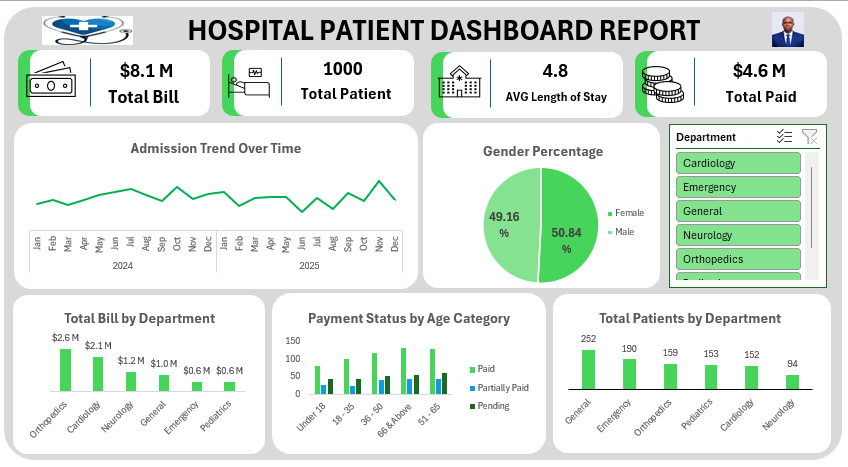
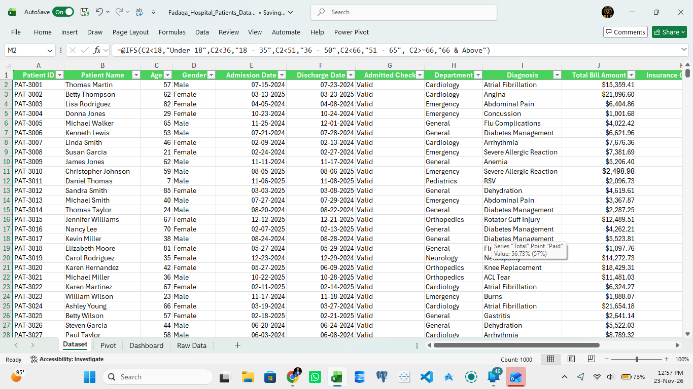
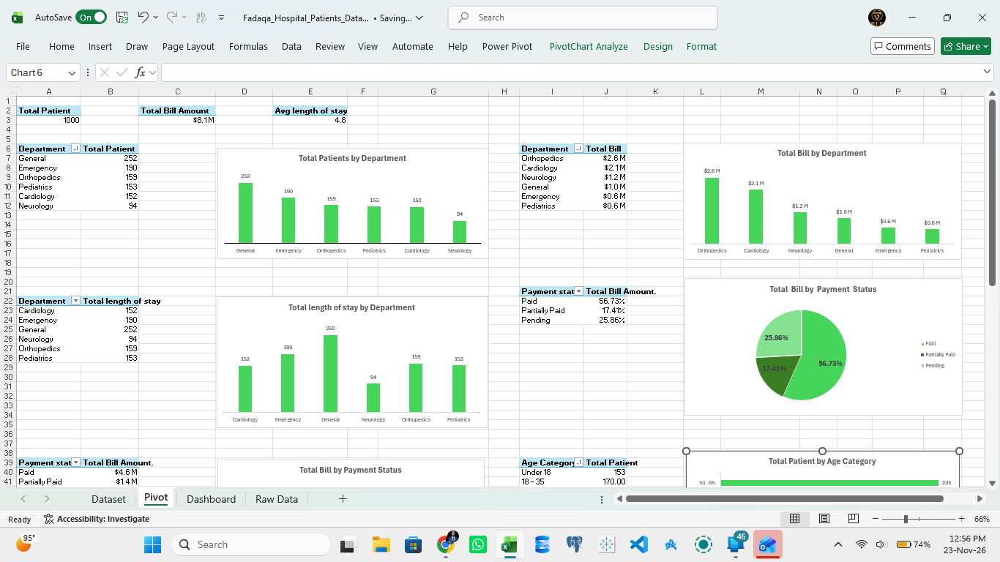

# Fadaqa Hospital Patient Analytics Dashboard

## Project Overview

An Excel-based data analytics project focused on analysing hospital patient records, patient demographics, departmental performance, billing and payment status.

The project demonstrates data preparation, Excel formulas, PivotTables, PivotCharts and dashboard development to transform raw hospital records into meaningful analytical insights.

## Dashboard Preview

## Project Objectives

- Prepare and validate hospital patient records.
- Analyse patient demographics and age distribution.
- Examine patient distribution across departments.
- Compare departmental billing performance.
- Evaluate payment status and associated billing amounts.
- Calculate patient length of stay.
- Develop an Excel dashboard for performance reporting.

## Dataset Overview

The dataset contains 1,000 patient records and includes:

| Category | Information |
|---|---|
| Patient Details | Patient ID, Name, Age, Gender |
| Admission | Admission Date, Discharge Date |
| Medical Information | Department, Diagnosis |
| Financial Information | Total Bill, Insurance Coverage, Payment Status |
| Calculated Fields | Age Category, Admitted Check, Length of Stay |

The workbook contains four worksheets: Raw Data, Dataset, Pivot and Dashboard.

## Tools and Technologies

- Microsoft Excel
- Excel Formulas (IF, IFS)
- PivotTables
- PivotCharts
- Excel Dashboard
- Data Cleaning and Validation

## Data Preparation and Analysis

The project involved:

1. Reviewing and organizing the original patient records.
2. Checking missing values and duplicate records.
3. Validating admission and discharge dates.
4. Creating age categories using Excel IFS.
5. Calculating patient length of stay.
6. Summarizing patient and financial data using PivotTables.
7. Developing charts and dashboard visualizations.

## Analytical Dashboard

The dashboard presents the following indicators:

- Total Patients
- Total Bill Amount
- Total Paid Amount
- Average Length of Stay
- Admission Trends
- Gender Distribution
- Total Billing by Department
- Payment Status by Age Category
- Patient Distribution by Department

## Key Findings

Based on the prepared dataset:

| Metric | Result |
|---|---:|
| Total Patients | 1,000 |
| Total Bill Amount | $8,053,143.44 |
| Total Paid Bill Amount | $4,568,527.32 |
| Average Length of Stay | 4.81 days |

**Departmental Insights**

- General recorded the highest patient volume (252).
- Orthopedics recorded the highest total billing ($2.55 million).
- Neurology recorded the lowest patient volume (94).
- Orthopedics had the highest average length of stay (8.38 days).

**Payment Insights**

- Paid: 564 patients.
- Partially Paid: 179 patients.
- Pending: 257 patients.

These findings are descriptive and do not establish causation or departmental efficiency.

## Project Screenshots

### 1. Prepared Dataset

Shows the structured patient records and calculated fields used for analysis.

### 2. PivotTables and PivotCharts

Shows the analytical summaries and visualizations developed in Excel.

### 3. Final Dashboard

Provides a consolidated view of hospital performance indicators.

## Business Insights

The analysis highlights differences in patient volumes, departmental billing and payment classifications.

These findings can help identify areas for further investigation in departmental capacity planning, financial monitoring and hospital reporting.

## Limitations

- The original dataset source has not been established.
- Currency denomination requires confirmation.
- One insurance coverage value requires verification.
- Some dashboard calculations and chart labels require correction.
- Patient information must be confirmed as synthetic or appropriately anonymized before public publication.

## Conclusion

This project demonstrates the use of Microsoft Excel for hospital data preparation, analysis and dashboard reporting. It highlights how structured patient records can be transformed into meaningful information for monitoring patient distribution, departmental billing and payment performance.

## Author

**Abdullahi Muhammed Soliu**

Data Analyst | Business Analytics | Business Intelligence

[Email](mailto:abdullahimuhammedsoliu0018@gmail.com) | [LinkedIn](mailto:https://www.linkedin.com/in/abdullahi-muhammed-soliu-074598417)
